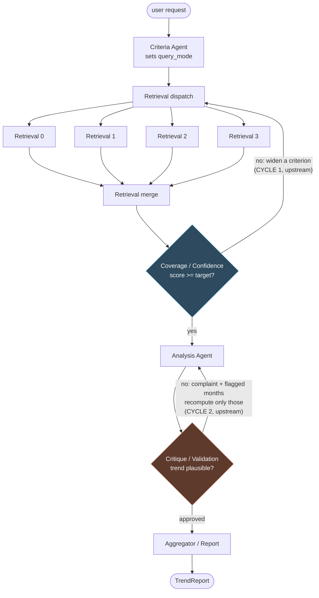

# Design Note — Metamorphic Testing of a Multi-Agent Housing-Trends Application

**Target market:** Hyderabad / Secunderabad (the brief's optional Indian-metro route)
**Deliverable stage:** design note (architecture + data source + MR sketches)

---

## 1. Data source and frozen snapshot

| | |
|---|---|
| Dataset | 99acres.com residential listings, Hyderabad slice |
| Origin | Kaggle — `arvanshul/gurgaon-real-estate-99acres-com`, titled *"Indian Real Estate – 99acres.com"*. Despite the slug, it is a multi-city archive: "properties of **Gurgaon, Hyderabad, Mumbai, Kolkata**". Verified on the dataset page. |
| Licence | Community Data License Agreement – Sharing – v1.0 (`cdla.io/sharing-1-0/`), verified on the same page |
| Scrape date | ≈ 26 Aug 2023 (latest `POSTING_DATE`) |
| Raw size | 9,487 rows × 55 columns, 14 MB |
| Integrity | SHA-256 in `data/raw/CHECKSUMS.txt`, re-verified on every load |

The raw file is **never modified**. `src/loading.py` derives a canonical frame
from it and `verify_snapshot()` aborts the run if the checksum moves, so a
silently-changed input cannot be mistaken for a code change.

### 1.1 Defects found in the snapshot

The data audit (`scripts/audit_hyderabad.py`, `audit/*.csv`) plus our own
verification found five defects. Each one is handled by a named filter, and
each drop is counted in the reject log rather than applied silently.

| ID | Defect | Evidence | Handling |
|----|--------|----------|----------|
| **D1** | `MIN_AREA_SQFT` / `MAX_AREA_SQFT` are **square metres despite the name** | ratio of the `AREA` display string to `MIN_AREA_SQFT` is **10.7639 at both p5 and p95** over 3,531 rows — unanimously the sq.m→sq.ft constant | area parsed from the `AREA` display string instead; using the named column would inflate every ₹/sqft figure **10.76×** |
| **D2** | int32 sentinel `2,147,483,647` (= 2³¹−1) in `MIN_PRICE`/`MAX_PRICE` on 5 rows; `0` on 75 | value equals the signed-32-bit maximum exactly | both dropped |
| **D3** | sale, rent and PG listings mixed | `PREFERENCE`: S=7,927 / R=1,467 / P=93 | sale only |
| **D4** | `BEDROOM_NUM` missing on 2,814 rows (29.7%) | **2,806 of them are `Residential Land`** — plots have no bedrooms; where both exist, heading-derived BHK agrees on 6,041 rows and conflicts on **0** | restrict to dwellings; this is structural inapplicability, not missingness |
| **D5** | area-entry errors in the tail | a **27 sqft "villa" at ₹2.15 cr** (₹796,296/sqft) and a **285,599 sqft** one, concentrated in `Independent House/Villa` | plausibility bounds on area, price and ₹/sqft, every drop counted |

### 1.2 Filter cascade (reproducible)

```
raw rows                           9487
sale only (PREFERENCE=S)           7927   -1560
dwellings only                     5085   -2842
parseable POSTING_DATE             4975    -110
price not zero/sentinel            4917     -58
parseable AREA (sqft)              4578    -339
area in [100, 20,000] sqft         4566     -12
price within plausibility bounds   4563      -3
psf in [1,000, 100,000] INR/sqft   4504     -59
canonical listings                 4504
```

### 1.3 The threat this snapshot carries

It is a **single-point scrape**, so older months contain only listings still
live on the scrape date. Monthly depth in the 12-month window
Sep 2022 – Aug 2023, after cleaning:

```
2022-09   24      2022-12   29      2023-03   58      2023-06   541
2022-10   34      2023-01   21      2023-04  158      2023-07  1689
2022-11   25      2023-02   23      2023-05  304      2023-08  1557
```

**96.5% of the window's listings fall in its last six months.** The medians of
the thin months swing ₹4,104 → ₹8,567/sqft on 21–34 listings, which is
sampling noise, not a market move. Two consequences drive the whole design:

1. The report carries a per-month **`sufficient`** flag (n ≥ 50). MRs that
   compare months are declared only over the sufficient subdomain — this is
   the "input subdomain on which it should hold" each MR must state.
2. A synthetic snapshot with controlled monthly depth is generated alongside
   the real one. It is **not** a replacement: it is the control that lets us
   tell a *harness bug* from a *data artifact*, which is a distinction the
   root-cause analysis is required to make and cannot make from real data
   alone.

---

## 2. The output contract

Fixed **before** any MR, because "the trend is unchanged" is unfalsifiable
until "the trend" is a named, finite set of numbers. Defined in
`src/contract.py` as `TrendReport`:

| Field | Meaning |
|---|---|
| `window_months` | exactly 12 months, ascending |
| `monthly[]` | per month: `n_active`, `median_psf`, `median_price`, `p25_psf`, `p75_psf`, `median_age_on_site_days`, `month_is_sufficient` |
| `locality_rankings[]` | top localities by median ₹/sqft, with `rank` |
| `yoy_median_psf_pct` | move between first and last **sufficient** month |
| `yoy_span_months` | how many months that actually spans |
| `n_listings_total` | listings in the window after criteria |
| `currency_unit`, `area_unit` | display units, carried so unit-invariance is observable |
| `criteria`, `provenance` | the slice described; seeds, loop counts, trace |

Derived series — the usual subjects of an MR: `psf_series()`,
`count_series()`, `price_series()`, `pct_change_series()`, `ranking_order()`,
`age_series()`, `sufficient_months()`.

Four contract decisions that exist specifically to keep MRs meaningful:

- **Median, not mean.** The price tail is heavy and contaminated (D5); a mean
  would make every invariance MR fail for reasons unrelated to the agents.
- **Counts reported separately from prices.** Duplication and band-widening
  move these in *different* directions; a fused statistic would hide exactly
  the faults we hunt.
- **`yoy_span_months` is reported.** Calling a field "yoy" while silently
  measuring six months would let the window-shift MR assert on an undefined
  quantity. On the real snapshot the headline is **−6.41% over 6 sufficient
  months**, and the report says so.
- **`month_is_sufficient` exists at all.** The project design note's contract
  had no sufficiency concept, which would have let the system publish a median
  computed from a handful of listings with no flag. Named in full rather than
  `sufficient`, which read ambiguously at call sites.

### 2.1 Age on site, and why it is not "days on market"

`median_age_on_site_days` fills the design note's `median_days_on_market`
slot, but is deliberately not called that. It is
`scrape_date − posting_date` for listings live at the scrape, which measured
across the snapshot gives a median of 37 days (p10 6, p90 108).

Two reasons the honest name matters:

1. **It is right-censored.** Every listing in a single-point scrape is still
   live, so we observe how long each has *been* listed, never how long it took
   to sell.
2. **It is length-biased.** Slow listings accumulate in a snapshot while fast
   ones exit, so a live-listing sample over-represents slow movers and the
   median *overstates* typical time-to-sale.

It is therefore a secondary statistic and **no metamorphic relation asserts on
it**. Reporting it as "days on market" would be a false claim about what was
measured.

---

## 3. Agent architecture

Six agents over a shared state, following the Reads/Writes contract of the
project design note. The graph is **not** a linear pipeline: it carries two
cycles, both implemented as genuine LangGraph conditional edges.



| Agent | Reads | Writes |
|---|---|---|
| **Criteria Agent** | `user_query` | `filter_spec`, `query_mode` |
| **Retrieval Agents** (several, cooperating) | `filter_spec`, `query_mode`, `retry_count` | `retrieval_report` (one entry each) |
| **Coverage / Confidence Agent** | `raw_listings`, `filter_spec` | `coverage_score`, `coverage_verdict`, `widened_filter_spec` |
| **Analysis Agent** | `raw_listings`, `critique_complaint` | `trend_stats` |
| **Critique / Validation Agent** | `trend_stats` | `critique_verdict`, `critique_complaint` |
| **Aggregator / Report Agent** | `trend_stats`, `coverage_score` | `final_report`, `narrative` |

### 3.1 The three required control-flow properties

**(a) Feedback loop — a downstream agent sends work back upstream.**
**Cycle 2: Critique → Analysis.** A rejection carries a *specific complaint*
naming the months at fault, and Analysis recomputes only those months. The
payload is surgical rather than a blanket re-run.

**(b) Conditional / iterative control step.**
**Cycle 1: Coverage → Retrieval.** The Coverage agent computes
`coverage_score = sufficient_months / 12` plus geographic spread, and either
proceeds or widens the binding criterion and re-runs the retrieval agents.
Both cycles are capped (`max_retry_rounds`, `max_critique_rounds`), so
termination is guaranteed, and both record their decision in `provenance`.

**(c) Genuine dependency — one agent's output changes what another *does*.**
The Criteria Agent sets **`query_mode`**, and the Retrieval agents execute a
**different algorithm** as a result: exact locality-name matching, or
great-circle (haversine) radius search from a point. These are not the same
algorithm over different rows — one is a set membership test, the other a
distance computation. 94.7% of the canonical frame carries usable coordinates;
rows without a location are *excluded* from a radius query rather than kept,
because a radius query is a claim about geography and an unlocated row cannot
satisfy it.

### 3.2 Several cooperating retrieval agents

The brief asks for "several cooperating agents each scan listings against a
set of user-specified criteria". Retrieval is therefore fanned out into N
parallel graph nodes (default 4), each scanning its own shard, assigned by a
stable `sha256(seed:listing_id)` hash. They write into an additive channel and
a merge node reassembles the result in canonical order, so the answer cannot
depend on which agent finished first — a property
`test_answer_is_independent_of_retrieval_agent_count` asserts across 1, 2, 4
and 8 agents.

### 3.3 Why the loops are necessary, not decorative

**Cycle 1 is forced by the data.** A plausible query — "3 BHK in Gachibowli
over the last twelve months" — matches 111 listings, of which only **one
month** reaches the sufficiency threshold. Without the loop the system either
returns a report that is mostly empty months, or silently over-broadens the
query and reports a number that does not answer the question asked. The loop
converts an unanswerable query into an answerable one **while recording which
constraint it relaxed**, which the user needs in order to read the number at
all. Measured: coverage progresses **0.083 → 0.167 → 0.500**, at which point
the target is met and the agent proceeds.

A linear pipeline cannot do this: the decision to widen depends on an
aggregate that only exists after retrieval has run.

**Cycle 2 is forced by defect class D5.** The snapshot contains area-entry
errors that survive any blanket filter — a 400 sqft villa at ₹8.3 crore is
individually plausible and only suspicious in aggregate. Validating every
listing on every run is wasteful and also discards legitimate luxury stock, so
escalating **only for the months whose aggregate looks wrong** is why the
complaint carries flagged months. Measured, with the contamination retained:
targeted recomputation shifts **7 of 12 monthly medians** (up to **+5.50%**),
**changes the locality ranking order**, rejects **125 listings** on the demo
query and moves the headline from **−10.9% to −13.6%**.

### 3.4 Where the local model sits

In LLM mode (`agent_mode=LLM`) four agents delegate their *judgment* to a
local Qwen2.5 via Ollama: the Criteria agent chooses `query_mode` from the
request; the Analysis agent reviews the **grey zone** of statistically unusual
listings (robust |z| between 2.0 and 3.5) by reading their descriptions; the
Critique agent judges which months look implausible; the Aggregator writes the
summary.

**Every statistic stays deterministic Python in both modes.** An LLM computing
a median would make every metamorphic relation meaningless. The model supplies
judgment and language; the arithmetic is never delegated. A parity test asserts
that with the critique agent held fixed, both modes produce byte-identical
series.

### Four prompt-hygiene constraints

These are **design rules, not implementation details**. Each was forced by a
metamorphic relation that failed without it (see `docs/DIAGNOSIS.md` Finding 8):

1. **Listings are presented by position, never by identifier.** Ids in the
   prompt let a bijective relabelling change the text the model saw — a 0.630
   violation rate on the relabelling relation. An identifier carries no
   information about whether a description corroborates a price.
2. **The review batch is sorted on every displayed field** (a total order).
   Sorting on a subset left listings tied on (psf, price, area) in input order,
   so reordering the rows changed the prompt. The reorder relation scored 0.000
   across 108 runs only because no tie happened to flip.
3. **The batch is deduplicated on content**, and a verdict applies to every row
   carrying that content. Taking the top N of a duplicated set returns N/2
   distinct listings twice; applying a verdict to one twin and not the other
   would also break exact doubling.
4. **The critique table is rendered in canonical units with counts withheld.**
   Display units let a ₹lakh/sq.m re-expression change which months were called
   anomalous; counts let duplication do the same.

What makes these constraints *sufficient* rather than merely helpful is the
measured determinism: a probe of 20 repeats at temperature 0 with a fixed seed
returned **20/20 identical replies**, so identical prompt plus deterministic
decoding implies identical judgment. Prompt invariance can therefore be
asserted by test, with no inference at all.

Constraint 4 is a **trade-off, not a free win**: withholding counts closed the
duplication fault but made the window-shift and price-shift relations worse
(0.222 → 0.667 and 0.222 → 0.333), because the model then judges purely on the
median series. The reasoning for favouring invariance is in `REPORT.md` §8.6.

Temperature is 0 and the harness's recorded seed is passed to the model on
every call, so the **model is a third reproducibility artifact** alongside the
frozen snapshot and the seed list. Responses are cached by
`(prompt, seed, model)` hash; the cache doubles as a replay artifact. Calls
that never yield parseable, valid output fall back to a recorded default and
**every fallback is counted and reported** — a high fallback rate means the
LLM path is weaker than it looks, and the report must say so rather than
absorb it silently.

## 4. Metamorphic relation catalogue

Eleven MRs across the three required families (eight is the minimum): five
invariance, four monotonic, two directional. Every one is a statement about
`TrendReport` fields and nothing else. `R` is the source report, `R'` the
follow-up.

The brief singles out one of these for the Indian-metro variant — *"converting
₹ crore ↔ ₹ lakh … must not move the trend or the rankings"* — which is **I5**.

### Invariance

| ID | Transformation | Relation | Subdomain | Tolerance | Fault exposed if violated |
|----|---------------|----------|-----------|-----------|---------------------------|
| **I1** | permute listing rows | every field of `R'` equals `R` | all criteria sets | counts exact; floats rel. 1e-9 | order-dependent aggregation; unstable ranking tie-break; shard assignment leaking row order |
| **I2** | change display units (₹→₹ lakh, sqft→sq.m) | `pct_change_series`, `ranking_order`, `count_series` identical; `median_psf` scales by exactly the unit factor | all criteria sets | rel. 1e-9 | hard-coded unit assumptions; the D1 sq.m/sqft confusion; percentages computed after rounding |
| **I3** | duplicate every listing (2×) | per-month `median_psf`, `median_price`, `p25`, `p75` and `ranking_order` unchanged; `n_active` exactly doubles | months already `sufficient` **only** — see note | medians rel. 1e-9; counts exactly 2× | dedup-by-id silently collapsing rows; count double-counting |
| **I4** | bijective relabel of `listing_id` | every field of `R'` equals `R` | all criteria sets | exact | agent keyed on id hash/order; shard-by-id-hash changing the accepted set |
| **I5** | convert the display currency **₹ lakh → ₹ crore** | `pct_change_series`, `ranking_order`, `count_series` identical; medians scale by exactly 10² | the lakh-denominated projection of each base input (a `prepare` hook sets the source to lakh) | rel. 1e-9 | a hard-coded currency assumption, or a percentage computed after rounding to the display unit |

> **I3 is deliberately scoped, and we predict it will fail if it is not.**
> Doubling every listing doubles `n_active`, which flips `sufficient` from
> false to true for any month holding 25–49 listings. That changes *which*
> months enter `yoy_median_psf_pct`, so the headline figure and
> `yoy_span_months` legitimately move. The property does not hold for those
> fields — the MR is a hypothesis, not an axiom. We therefore declare I3 over
> the per-month price statistics on already-sufficient months and exclude the
> yoy fields, and we report the unscoped version's violation rate as evidence
> of the interaction rather than hiding it.

### Monotonic

| ID | Transformation | Relation | Subdomain | Tolerance | Fault exposed if violated |
|----|---------------|----------|-----------|-----------|---------------------------|
| **M1** | add ₹500,000 to every price in month *m* | `median_price[m]` rises by ≈X; all other months unchanged; no month's median decreases | the **band-free projection** of each base input — a `prepare` hook strips the price band from *both* runs — and X small enough that no listing crosses a plausibility bound | \|Δ−X\| ≤ 1e-6·X on the target month; others exact | month bucketing bleeding across boundaries; a price filter applied *after* the transform, clipping shifted rows |
| **M1raw** | as M1, but the price band is **left in place** | as M1 | **none — retained as the documented counter-example, not as a passing check** | as M1 | nothing: the relation itself is unsound. The shift moves listings across the band boundary, so the follow-up selects a different population. Measured: one crossing listing moved a 15-listing month's median by **−₹1,122,750** against an expected **+₹500,000** |
| **M2** | widen the price band (superset of listings) | `count_series'[i] ≥ count_series[i]` for every month | criteria that set a band, **conditioned on both runs taking the same path through cycle 1** | exact inequality | filter inversion; off-by-one on bounds; a retrieval agent serving cached results for stale criteria |
| **M3** | restrict to a locality subset | each month's count ≤ the all-locality count for that month | criteria with ≥2 localities, **conditioned on control-path stability** | exact inequality | leakage between retrieval shards; the Analysis agent merging results from a previous criteria set |

### Directional

| ID | Transformation | Relation | Subdomain | Tolerance | Fault exposed if violated |
|----|---------------|----------|-----------|-----------|---------------------------|
| **D1** | shift the window forward one month | the 11 overlapping months' `MonthStat` rows match the previous run exactly | window ends with both windows inside the data range | counts exact; floats rel. 1e-9 | off-by-one window arithmetic; month bucketing drift; an agent carrying state between runs |
| **D2** | scale all prices by *k* > 1 | `median_psf`, `median_price` scale by exactly *k*; `pct_change_series` and `ranking_order` invariant | *k* such that no listing crosses the ₹/sqft or price bounds | scaled values rel. 1e-9; pct changes abs. 1e-9 | unit mishandling; plausibility filter applied post-transform; non-linear aggregation |

> **M1 required two refinements, both recorded.** Shifting the band
> alongside the data was tried first and made things *worse* (12/16 against
> 6/16), because it holds the target month's population fixed while changing
> every untouched month's. The adopted form strips the band from both runs.
> A residual 0.139 violation rate remains and is explained, not hidden: a
> constant shift in *price* is not a constant shift in *price-per-sqft*
> (Δ/area differs per listing), so the psf-based outlier filter legitimately
> rejects a different set. See `docs/DIAGNOSIS.md` Findings 2 and 5.

> **M2 and M3 are conditional, and that is a finding rather than a hedge.**
> Coverage depends on listing counts, so a transformation that changes counts
> can change how many relaxation rounds cycle 1 fires — and therefore the
> final criteria, and the population, for the whole window. Measured on the
> synthetic snapshot: a locality *subset* returned **85 → 331** listings
> because the subset lowered coverage and triggered extra widening. Both
> relations are therefore reported twice, unconditionally and over the
> relaxation-stable subdomain, with the divergence count stated. Conditioned
> that way, every synthetic violation of I3, M2 and M3 disappears.

### 4.1 Boundary interaction, stated up front

M1 and D2 both transform prices, and the loader enforces plausibility bounds
on price and ₹/sqft (D5). A large enough shift or scale pushes listings across
those bounds, **changing the population** — at which point the relation
genuinely does not hold. This is an MR-design trap, not a system fault. We
handle it by declaring each MR's subdomain in terms of *k* and *X* that keep
the population fixed, verifying that precondition at run time, and reporting
how often it bound.

### 4.2 Statistical protocol

- **36 distinct base inputs per MR**, above the required 30 — generated
  criteria sets varying window end, BHK, locality breadth and price band.
  Every input satisfies every relation's applicability precondition, so all
  eleven relations are evaluated on all 36.
- **k = 3 fixed seeds** `[11, 23, 47]` per base input, for source and
  follow-up runs alike, since shard assignment, relaxation order and (in LLM
  mode) the model's own sampling are all seeded. **1,188 checks per sweep**
  (11 × 36 × 3), each comprising two full pipeline runs.
- Report per MR: seed list, base-input count, violation count, violation rate
  and a **95% Wilson confidence interval** (Wilson, not normal-approximation,
  because violation rates near 0 and 1 are expected and the normal interval
  misbehaves there).
- Stop when the interval is tight enough to support the conclusion drawn.

---

## 5. Open assumptions

Recorded per the brief's instruction to make and document reasonable
assumptions:

1. **`POSTING_DATE` is the listing's month.** It is a scrape-time posting
   timestamp, not a transaction date, so the series is an *asking-price*
   trend, not a sold-price trend. Stated as such throughout.
2. **`MIN_PRICE` is the asking price.** 9,075 of 9,487 rows have
   `MIN_PRICE == MAX_PRICE`; the 412 ranges use the lower bound.
3. **Hyderabad and Secunderabad are one market** (8,762 + 725 rows).
4. **n ≥ 50 defines a sufficient month.** A judgement call, not a derived
   threshold — and **measurement shows the headline figure is not robust to
   it**:

   | n ≥ | sufficient months | first sufficient | headline move |
   |-----|-------------------|------------------|---------------|
   | 10 | 12 | 2022-09 | **+87.18%** |
   | 25 | 10 | 2022-10 | **+87.18%** |
   | **50** | **6** | **2023-03** | **−6.41%** |
   | 75 | 5 | 2023-04 | **+7.08%** |
   | 100 | 5 | 2023-04 | +7.08% |
   | 300 | 4 | 2023-05 | +3.87% |

   The spread is **93.6 percentage points and the sign flips.** The reason is
   structural: the headline is measured from the first sufficient month, the
   early months hold 21–35 listings, and their medians are sampling noise, so
   the threshold effectively *selects* the answer.

   **The honest conclusion is therefore that this snapshot cannot determine
   the direction of the twelve-month move.** We report −6.41% at n ≥ 50 as the
   figure our stated contract produces, not as a finding about the Hyderabad
   market. Two independent observations point the same way: a 3 km radius
   slice around the IT corridor gives **+6.24%** against the metro-wide
   −10.9%, and the snapshot is survivorship-biased by construction (§1.3).
   **The cross-check was performed and settles it.** NHB RESIDEX
   (*Press Release July–September 2023*) puts Hyderabad at **+6.8%** on its
   HPI @ Market Price — a series explicitly based on asking prices, so
   methodologically matched to ours. Our own data gives **+7.08%** at n ≥ 75
   and **+6.24%** on the radius slice: agreement to within 0.3–0.6 points. The
   n ≥ 50 figure is the outlier and has the wrong sign, so the threshold was
   chosen badly rather than the data being uninformative.
   See `results/residex/cross_check.md`.

5. **PIN codes are unavailable.** The brief suggests filtering by locality
   *and* PIN code; the dataset has no PIN/ZIP/postal column, and the six-digit
   strings in its free text are latitude fragments. Locality — the brief's own
   example — is the filtering convention, with radius/geo as the alternative
   (§3.1c).

6. **The model is a reproducibility artifact.** In LLM mode the run depends on
   the model weights as much as on the snapshot and the seeds, so the model
   name, quantisation and digest are recorded alongside them. Temperature is
   pinned to 0 and the harness seed is passed to the model on every call.
